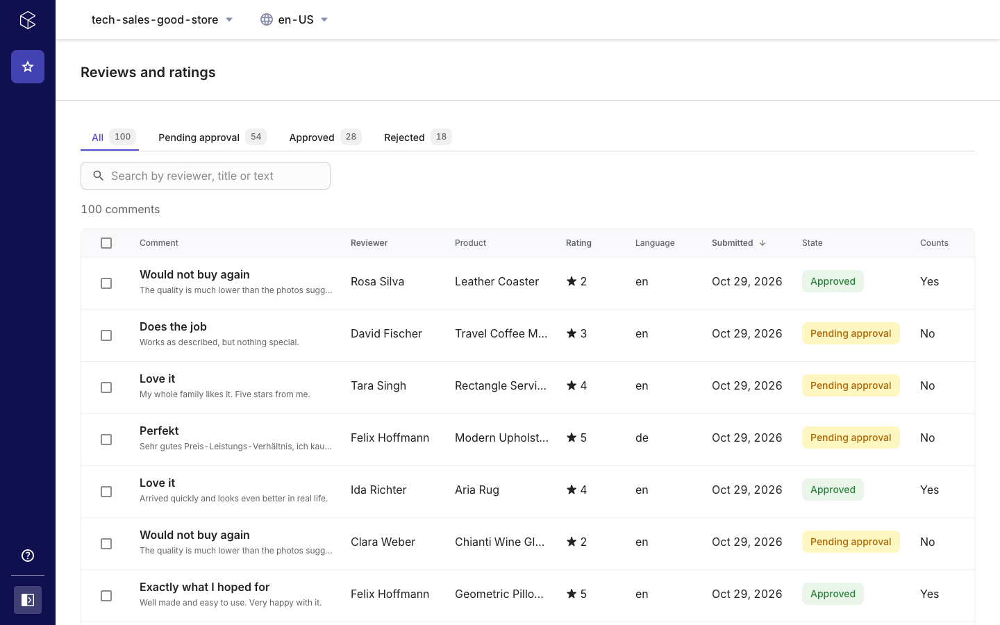
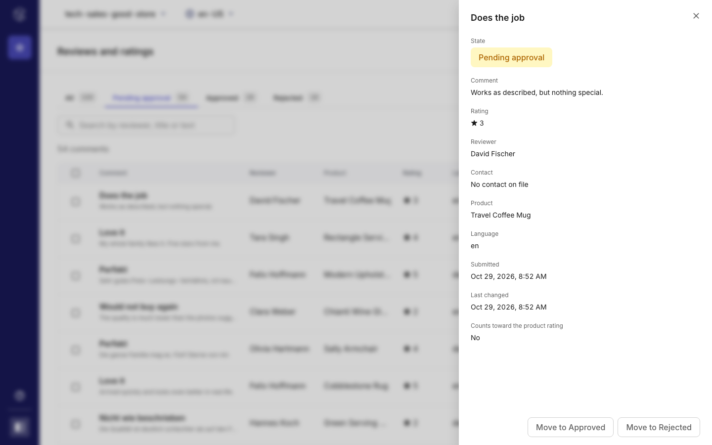

# Reviews and Ratings

> **commercetools Labs, unsupported.** Freely available reference code under the MIT license,
> shared as-is and not covered by commercetools support. See [SUPPORT.md](./SUPPORT.md) and [LICENSE](./LICENSE).

A Merchant Center custom application for moderating the product reviews customers write on your storefront.

Shoppers' reviews arrive as commercetools Reviews, and until someone decides about them they should not count toward a product's rating. This app gives your moderators one place for that work: a queue of all reviews with a tab per moderation state, search, sorting, a detail panel to read one comment in full, and approve or reject buttons, one at a time or in bulk. There is no ticket to open and no deployment to wait for; moderators work inside the Merchant Center they already use.

It is meant for teams that collect reviews through the commercetools Reviews API and need a lightweight moderation step, and for developers who want a worked example of a Merchant Center custom application built with Nimbus, the Merchant Center GraphQL proxy and Connect.



What you get when it is running:

- A review queue with state tabs and live counts, server-side paging and sorting, and search.
- A detail side panel, and single or bulk moves between states. The actions offered are always the transitions of the review's own state, so a different state graph works too.
- View and Manage permissions (controls are disabled, never hidden) and English and German texts.

The app only reads reviews and runs the `transitionState` update action through the Merchant Center GraphQL proxy. It owns no data and needs no server or API client of its own. A review is a commercetools Review; its moderation state is a `ReviewState` State.


## Status

Build, lint, type check and the 92 unit and component tests pass (the tests mock the GraphQL layer). The app has not yet been walked through against a live project: the `view_states` scope, behavior with thousands of reviews and the accessibility pass are open. See "Known limits and open checks" in [`FEATURES.md`](./FEATURES.md) and check the scopes against your own project before relying on it.

## What you need

- Node.js 22 and npm.
- A commercetools project with Merchant Center access, and an Organization admin who can register a custom application.
- The three review states (`pending-approval`, `approved`, `rejected`) in the project. [`docs/SETUP.md`](./docs/SETUP.md) has a script that creates them, and one that adds sample reviews to try the app.

## Try it

The app lives in `reviews-and-ratings-app/`, its own npm project (Connect requires the folder name to match `connect.yaml`).

```shell
cd reviews-and-ratings-app
npm install
cp ../.env.example .env.local   # set INITIAL_PROJECT_KEY and CLOUD_IDENTIFIER (gcp-eu, gcp-us, aws-eu, aws-us)
npm start                       # dev server, opens the Merchant Center
npm test                        # no project needed
```

`npm start` and `npm run build` read the project key and cloud from `.env.local`; without it they stop with a "Missing environment variable" error. Registering the application, installing it and the two deploy paths (Connect for production, Netlify for development and preview) are in [`docs/SETUP.md`](./docs/SETUP.md).

## Learn more

- What the app does, with screenshots: [`FEATURES.md`](./FEATURES.md)
- States and flow, with diagrams: [`docs/MODERATION-FLOW.md`](./docs/MODERATION-FLOW.md)
- Setup, registration and both deploy paths: [`docs/SETUP.md`](./docs/SETUP.md)



## Contributing

Issues and pull requests are welcome; see [`CONTRIBUTING.md`](./CONTRIBUTING.md).
